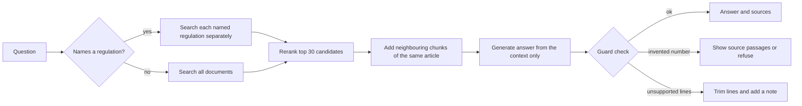

# Regulatory RAG: cited question answering over DORA and the EU AI Act

A retrieval-augmented generation (RAG) system that answers questions about two EU regulations, **DORA** (Regulation (EU) 2022/2554) and the **EU AI Act** (Regulation (EU) 2024/1689), in English and German. Answers carry their sources, a guard checks them against the retrieved text, and an evaluation harness compares the system with a classic RAG baseline on questions it was never tuned on.

> **Not legal advice.** This is a portfolio project. It has not been reviewed by a lawyer, and the indexed texts are the versions originally published in the Official Journal (see [Known limitations](#known-limitations)).

## Results

| | Classic RAG baseline | This system |
|---|---|---|
| **Locked test set** (10 questions x 3 runs) | 12/30 runs (40%) | **27/30 runs (90%)** |
| Development set (15 questions x 3 runs) | 9/45 runs (20%) | 42/45 runs (93%) |

Both systems use the same generator (Claude Haiku 4.5) and the same judge (Claude Sonnet 5.5). A run passes only if the judge rates the answer **correct, complete, grounded and relevant**. The test questions were written, committed and tagged (`test-set-locked`) before the later pipeline work, and were run once per system, after the pipeline was frozen (`pipeline-frozen`).

Test set, by criterion (runs out of 30):

| Criterion | Baseline | This system |
|---|---|---|
| Correct | 15 | 30 |
| Complete | 12 | 27 |
| Grounded | 27 | 30 |
| Relevant | 27 | 30 |
| **All four** | **12** | **27** |

Test set, by question (runs passed out of 3):

| Question | Topic | Baseline | This system |
|---|---|---|---|
| t01 | Definition of "importer" (AI Act) | 3 | 3 |
| t02 | Fine tier for Article 50 breaches (AI Act, Article 99) | 0 | 3 |
| t03 | Contents of the digital operational resilience strategy (DORA) | 0 | 3 |
| t04 | Human oversight of high-risk systems (AI Act) | 0 | 3 |
| t05 | Testing requirements in both regulations | 0 | 0 |
| t06 | German: which authority receives incident reports (DORA) | 3 | 3 |
| t07 | German: definition of "Anbieter" (AI Act) | 0 | 3 |
| t08 | Annex III, education and vocational training | 0 | 3 |
| t09 | Unanswerable (NIS2 deadline) | 3 | 3 |
| t10 | Unanswerable (Digital Services Act fine) | 3 | 3 |

The system is better on 5 questions, equal on 5 and worse on none. It fails one question consistently (t05, see [limitations](#known-limitations)).

**How much weight these numbers can carry.** Ten test questions is a small sample, so the direction (never worse, clearly better on half the questions) is more reliable than the exact percentages. The three repeats run at temperature 0 and are not independent samples, so the effective sample is the number of questions, not the number of runs. The judge is a stronger model than the generator but from the same model family, which may make it somewhat lenient toward the generator's style.

## Example

```
POST /ask   {"question": "What is an AI system under the AI Act?"}
```

```json
{
  "answer": "According to the EU AI Act, Article 3, Definitions: 'AI system' means a machine-based system that is designed to operate with varying levels of autonomy ...",
  "sources": "Sources: ai_act_en article 3",
  "warning": null,
  "regenerated": false,
  "contexts": [ { "doc": "ai_act_en", "article": "3", "page": 45, "text": "..." } ]
}
```

For a question the documents cannot answer (a GDPR deadline, for instance), the system declines and says so:

```json
{
  "answer": "I don't know. The context provided does not contain information about ... the GDPR ...",
  "sources": "Sources: none (the documents do not contain an answer)"
}
```

## How it works



| Stage | What it does | Where |
|---|---|---|
| Ingestion | Reads the PDFs with PyMuPDF, removes running headers and footers (lines whose digit-normalised shape repeats on at least half the pages), and splits at `Article N` / `Artikel N` headings and annexes. The recitals are not indexed | `src/ingest.py` |
| Chunking | Cuts each article along its own structure (numbered definitions, paragraphs, list items) into chunks of roughly 100 to 1100 characters. Every chunk starts with a label such as `[DORA (English) \| Article 3 \| Definitions]`, so the article number is part of the embedded text. 2003 chunks in total | `src/chunk.py` |
| Index | `all-MiniLM-L6-v2` embeddings in Chroma | `src/pipeline_v1.py` |
| Routing | If the question names a regulation ("AI Act", "KI-Verordnung", "DORA"), each named regulation is searched separately and its best chunks are kept. Otherwise all documents are searched together | `src/pipeline_v6.py` |
| Reranking | The vector search returns 30 candidates, and the cross-encoder `BAAI/bge-reranker-v2-m3` keeps the best 4 (3 per regulation when two are named) | `src/pipeline_v2.py` |
| Neighbour expansion | Adds the chunk before and after each kept chunk from the same article, and fills small gaps between kept chunks, so that lists stay whole | `src/pipeline_v3.py`, `src/pipeline_v6.py` |
| Generation | Answers only from the context, copies its wording, keeps every item and exception, and says "I don't know" when the context has no answer | `src/pipeline_v7.py` |
| Guard | See below | `src/guard.py`, `src/pipeline_v7.py` |

### The guard

The model's answer is checked in plain code, without another model call:

- **Invented numbers.** Any number in the answer that does not appear in the retrieved text is flagged. The model gets one retry. If the answer is still flagged, the user sees the source passages instead (or a refusal, when the answer has no overlap with any retrieved passage). The system fails closed.
- **Unsupported statements.** Lines with almost no word-sequence overlap with the retrieved text are removed, and the answer ends with a note saying how many statements were removed.
- **Refusals** that are short and contain no digits are not checked, since they make no factual claims.
- **Sources** are built in code from the chunks whose text the answer actually uses, so they do not depend on the model citing anything.

The guard checks that content is grounded in the retrieved text. It does not check that the content is relevant to the question or attributed to the right article (the LLM judge covers that in evaluation).

## What each change contributed

Measured on development set 1 (5 questions), with a local `llama3.1` generator and keyword scoring (a question passes if enough of its key facts appear in the answer). This is a small development set that the fixes were built against, so read it as a record of what each change fixed.

| System | Score | What it fixed |
|---|---|---|
| Classic RAG baseline (fixed 1000-character chunks, top 4) | 1/5 | |
| + article-aware chunking with article labels | 3/5 | Wrong article retrieved; definitions found |
| + cross-encoder reranker | 4/5 | Right article found but ranked too low |
| + neighbour expansion | 5/5 | Long lists cut off between chunks |

Two more changes were found with later development sets: routing (a two-regulation question went from fail to pass, development set 3, from 4/5 to 5/5) and the guard.

## Failure analysis: what broke and how it was fixed

| What went wrong | Cause | Fix |
|---|---|---|
| Asked for the maximum fine for an AI Act breach, the baseline answered EUR 1 500 000 | Two near-identical sentences in different articles. The baseline retrieved Article 100 (EU institutions) instead of Article 99 (companies: EUR 35 000 000 or 7 %) | Chunks labelled with their article number |
| Lists of prohibited practices and provider obligations came back half-complete | Fixed-size chunks cut the lists, and only 4 chunks reach the model | Structure-aware chunking, reranker, neighbour expansion |
| The provider-obligations article ranked 7th, 14th and 20th in vector search, so the model never saw it | Many articles discuss "providers" and "high-risk" and score almost the same | Cross-encoder reranking over 30 candidates (rank 7 became rank 1) |
| All DORA headings disappeared during ingestion | The header and footer rule treated `Article N` as junk, because those lines appear on most pages after page 22 | Headings are exempt from the junk rule |
| A German DORA definition could not be found | The German text numbers definitions as `10. „term“`, and the splitter only knew `(10)`, so four definitions ended up in one chunk | Splitter extended to the German format |
| A question about both regulations answered only from DORA | One search for two topics is dominated by the longer, more distinctive half. Raising the candidate count from 30 to 50 did not help | Routing: one search per named regulation |
| A small local model invented a penalty ("at least three years or a fine of at least EUR 30 000") | The model filled a gap from memory | The guard flags numbers that are not in the sources and shows the source text instead |
| The guard deleted a correct refusal | An explanatory "I don't know" sentence has no overlap with the sources, so it looked unsupported | Short refusals without digits skip the check, and an answer emptied by trimming becomes a plain refusal |
| Keyword scoring passed an incomplete answer at its minimum threshold | Counting key facts cannot see which items are missing | An LLM judge rates correctness, completeness, grounding and relevance, and fails that answer for its missing items |
| The baseline answered "what must the resilience strategy include" with the management body's duties | Two neighbouring DORA articles both talk about the strategy, and the baseline retrieved the wrong one | Same fix as the first row, and a good example of why the test set marks confusable articles |

## Evaluation design

- **Questions.** 25 questions: three development sets (5, 5 and 5), and a locked test set of 10. Cases covered: direct lookups, multi-passage lists, cross-document questions, German questions, annex questions, and unanswerable questions (to check that the system declines instead of answering from memory). Expected answers and key facts were written by hand from the regulation text.
- **Locked test set.** The test questions are committed under the tag `test-set-locked`. The evaluation script refuses to run them unless `--unlock-test` is passed, checks that they still match the tagged version, asks for a typed confirmation, and refuses a second run for the same system.
- **Development scoring.** Fast keyword scoring (`eval/run_eval.py`) reports whether the key facts were in the retrieved text and in the answer, which separates retrieval failures from generation failures.
- **Final scoring.** An LLM judge (`eval/judge_eval.py`) rates each answer on four criteria and writes a one-sentence reason. Each question is run three times, and results are saved after every run. The generator and judge are recorded in each results file.

## Known limitations

- **Cross-document questions can still come back incomplete.** The one consistent test failure (t05, testing requirements in both regulations) retrieved DORA's advanced-testing article (Article 26) instead of the testing-programme article (Article 24). The same pattern appears in one development question (q014, DORA's Article 1). A plausible cause is that 3 chunks per regulation is too few. This was not tested, because the pipeline was frozen before the test run.
- **Routing depends on the question naming the regulation.** A question that says "financial entities" without naming DORA uses the unrouted search.
- **The recitals are not indexed**, so a question answered only in a recital gets "I don't know".
- **Versions.** The indexed texts are the versions originally published in the Official Journal. EUR-Lex lists a later consolidated version of the AI Act (27 July 2026); the two texts have not been compared, so answers may not reflect later amendments.
- **The guard has blind spots.** It checks digits, not numbers written as words. Its overlap check can misfire on a faithful paraphrase. It does not check relevance or attribution. In the test run it acted on 6 of 30 runs (a replaced answer in 3 runs of t09, one removed statement in 3 runs of t05). The draft before the guard was not saved in those runs, so the effect cannot be reconstructed exactly.
- **The fallback message is in English** even for German questions.
- **Embeddings.** The embedding model is English-only. All German questions passed, but German vector distances were looser than English ones. Multilingual embeddings and hybrid keyword search were not tried.
- **Small, same-family evaluation.** See the note under [Results](#results).

## Run it

### 1. Get the data

The PDFs are not in the repository. Download both regulations in English and German from EUR-Lex (the "Official Journal" versions) and save them as:

```
data/dora_en.pdf        https://eur-lex.europa.eu/eli/reg/2022/2554/oj/eng
data/dora_de.pdf        same regulation, German
data/ai_act_en.pdf      https://eur-lex.europa.eu/eli/reg/2024/1689/oj/eng
data/ai_act_de.pdf      same regulation, German
```

### 2. Run it locally

```powershell
uv sync
uv run python -m src.pipeline_v1 build      # builds the vector index (a few minutes)
```

Create a `.env` file (never commit it):

```
ANTHROPIC_API_KEY=your-key-here
```

Then pick the generator. For API generation:

```powershell
$env:LLM_PROVIDER="anthropic"
$env:LLM_MODEL="claude-haiku-4-5-20251001"
uv run uvicorn src.api:app --port 8000
```

For free local generation, install [Ollama](https://ollama.com), run `ollama pull llama3.1`, and leave `LLM_PROVIDER=ollama` in `.env`. Local generation is weaker, and the guard matters more with it. On macOS or Linux, use `export VAR=value` instead of `$env:VAR="value"`.

Then open http://127.0.0.1:8000/docs, or call it directly:

```powershell
Invoke-RestMethod -Uri http://127.0.0.1:8000/ask -Method Post -ContentType "application/json" -Body '{"question": "What is an AI system under the AI Act?"}'
```

### 3. Run it with Docker

The image contains the two local models and the built index, so it starts without internet access to Hugging Face. Put the API key in a file called `docker.env` (git-ignored):

```
ANTHROPIC_API_KEY=your-key-here
```

```powershell
docker build -t reg-rag .
docker run --rm -p 8000:8000 --env-file docker.env reg-rag
```

The image is about 14.6 GB, mostly PyTorch with its CUDA libraries and the two models. A CPU-only PyTorch build would shrink it considerably (not done).

### 4. Reproduce the evaluation

```powershell
# keyword scoring on development sets (add --set dev2, dev3, or all)
uv run python -m eval.run_eval --system final --set dev1

# LLM-judged evaluation, three repeats per question (needs the Anthropic variables above)
uv run python -m eval.judge_eval --system baseline --set all --repeats 3
uv run python -m eval.judge_eval --system final --set all --repeats 3
```

Available systems: `baseline`, `chunked`, `reranked`, `expanded`, `cited`, `guarded`, `routed`, `final`. A full judged pass over the development sets costs roughly a dollar or less per system (Haiku generation, Sonnet judging), depending on current API prices. The test set is locked, as described above.

## Repository layout

```
baseline/     the frozen classic RAG used as the comparison
src/
  ingest.py       PDF reading, header/footer removal, article and annex splitting
  chunk.py        structure-aware chunking with article labels
  guard.py        groundedness checks
  llm.py          generator selection (Ollama or Anthropic)
  pipeline_v1.py  chunked index
  pipeline_v2.py  + reranker
  pipeline_v3.py  + neighbour expansion
  pipeline_v4.py  citation-prompt experiment
  pipeline_v5.py  + guard
  pipeline_v6.py  + routing
  pipeline_v7.py  final: routing + guard
  api.py          FastAPI service (/ask, /health)
eval/
  golden_set.json questions, expected answers, key facts
  run_eval.py     keyword scoring
  judge_eval.py   LLM-judged evaluation and the test-set lock
scripts/      diagnostic scripts used during development
Dockerfile
```

## Author

<your name> | <contact link>

## Licence

<choose a licence, for example MIT>